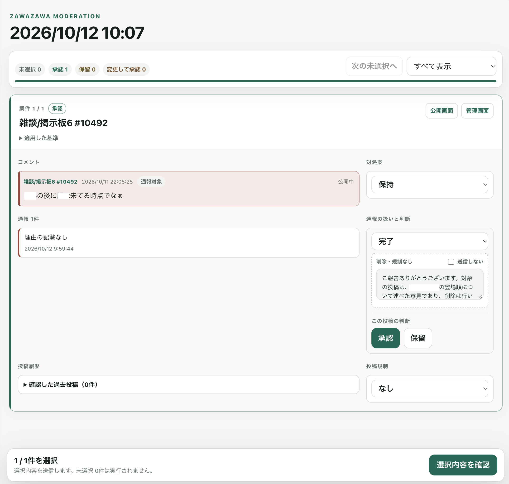
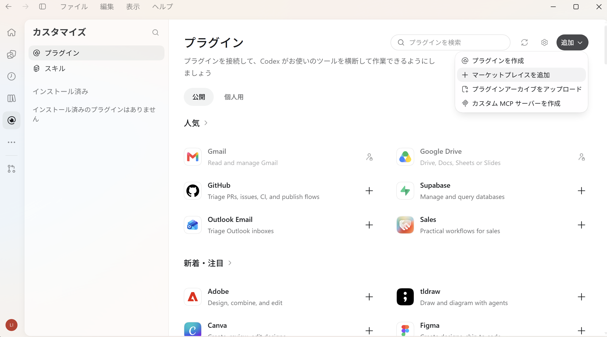

# ZAWAZAWA Moderation Review

## 何ですかこれは？

- ZAWAZAWA掲示板の管理人に向けた、通報処理お助けツールです。
- Codex（ChatGPTデスクトップアプリ内にあります）向けの拡張機能で、未処理通報を調査し、Wikiごとの運用基準に沿った対処案を作成・実行します。
- 原神wiki2代目管理人が引退する間際に試作し、便利使いしていたものです。as-isでのご提供です。自己責任において自由に改変・使用してください。

## 何ができるの？



1. Codexのチャットで`/zawazawa-moderation`と打つと、未処理の通報すべてをAIが取得し、対処案（「削除 / 削除＋規制 / 何もしない」＋通報者へのメッセージ）を作成して画像のような一覧にまとめます。
2. 一覧には通報対象の前後のコメントや過去の投稿も表示されます。判断に必要な情報がまとまった状態で、AIの対処案を1件ごとに承認、もしくは訂正できます。
3. 承認・訂正を終えたら実行はAIが担ってくれます。
4. 訂正を入れた箇所は、AIが判断基準を自己点検し、必要に応じ修正します。基準はご自身で調整も可能です。
5. ユーザーの承認を求めずに通報対処を行う自律実行モードもあります。AIの判断が信頼できるようになったらONにするとよいです。

## 注意点・限界

1. いわゆるVibe Coding Shitです。SKILL文書は一部かなり手を入れましたが、開発者はコードを1行も書いていません。文書も、このREADME以外はAIに大部分を投げています。とりあえず動くからヨシ！として公開に踏み切っています。
2. 基準を自己修正する機能はあまり試せていません。この機能がきちんと動き始めた時には、もう運用基準がまとまりきっていたので。
3. Macで開発と運用をしていました。Windowsは仮想環境で試したのですがMCPツールの読み込みがうまくいきませんでした。
4. 私の管理人引退に伴い、今後の保守・更新はございません。**ツールに脆弱性があっても更新はされません！** 定期的にnpmやChromium, Playwrightのアップデートを確認し、必要に応じ更新してください。
5. ZAWAZAWA・Wikiwiki公式に何らの許諾も得ておりません。

## 対応環境

- macOSまたはWindowsのPC
- Codexデスクトップアプリ（無料プランでOK。動かすだけならgpt-6-luna highくらいで十分）
- 対象ZAWAZAWAグループの管理権限

## Codexデスクトップへインストール



次の操作をCodexデスクトップの画面で行います。（アプリのバージョンにより表示名や位置が変わることがあります。）

1. サイドバーの「プラグイン」を開きます。
2. 「追加」または「ページの操作」メニューから「マーケットプレイスを追加」を選びます。
3. 「プラグインマーケットプレイスを追加」ダイアログに、次のとおり入力します。

   ```text
   ソース (Source): linalena-gw/Zawazawa-Moderation
   Git ref: main
   Sparse paths: 空欄
   ```
4. ダイアログの「マーケットプレイスを追加」を押します。
5. プラグイン一覧でマーケットプレイス「ZAWAZAWA Moderation」を開き、`zawazawa-moderation-review`の詳細画面で「インストール」または「＋」を押します。

## インストール後の初回設定

専用の空フォルダを作り、Codexでローカルプロジェクトとして開きます。ここが設定や運用基準、結果報告の置き場になります。OneDrive同期フォルダ（Windowsで、緑のチェックマークが入って表示されるやつ）は使わないでください。セットアップで保存先を尋ねられたら、「いま開いているフォルダ」と答えてOKです。

プロジェクトの新しいチャットで`/zawazawa-setup`を呼び、案内に沿って設定してください。運用基準は後からでも調整できます。専用ブラウザでは管理権限のあるアカウントでログインしてください。

## 通常の使い方

- 初回設定後は、先ほど用意したプロジェクトのチャット内で`/zawazawa-moderation`と打ってください。
- 初期モードは`restricted`です。エージェントが対処案を作ります。1件ごとに承認・変更をしてください。戻された内容をエージェントが実行します。
- 全案件をエージェントが判断・実行する`autonomous`モードも可能です。切り替える場合、zawazawa.config.jsonファイルを開き`restricted`を`autonomous`に書き換えてください。スケジュールタスクにしておけば勝手に回してくれるようになります。

## 安全とプライバシー

- 認証は専用ブラウザプロファイルにだけ保存し、普段使いのブラウザからCookieを取得しません。
- Node.js、コードと依存関係、共用Chromiumはユーザー領域の専用ホームに保存し、Codexのユーザー設定にはMCP起動情報を登録します。
- 通報者を識別する情報は保存・表示しません。
- 一覧での判断、実行許可、実際の送信、成功確認を分離します。
- 結果報告には投稿本文と通報理由が含まれるため、Git管理・共有しません。

## 変更する場合

プラグイン本体を変更する場合の導入、プレビュー、テスト、検証は[プラグインREADMEの開発節](./plugins/zawazawa-moderation-review/README.md#開発)を参照してください。

## License

[MIT License](./LICENSE)
